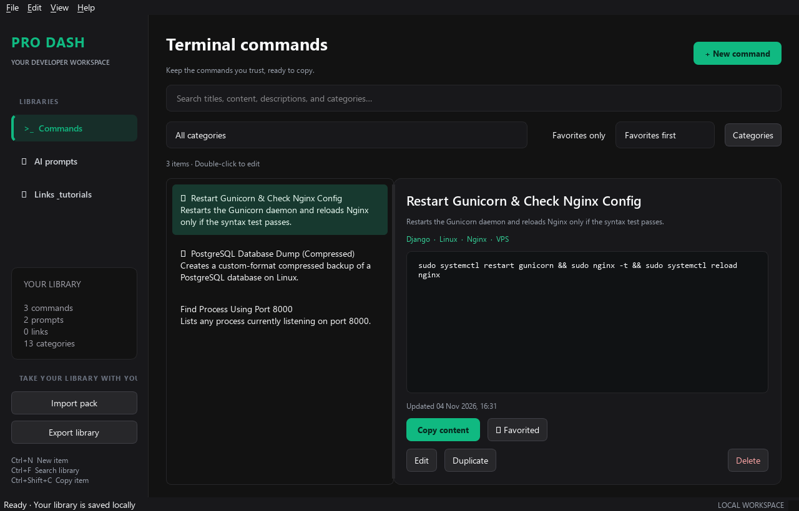
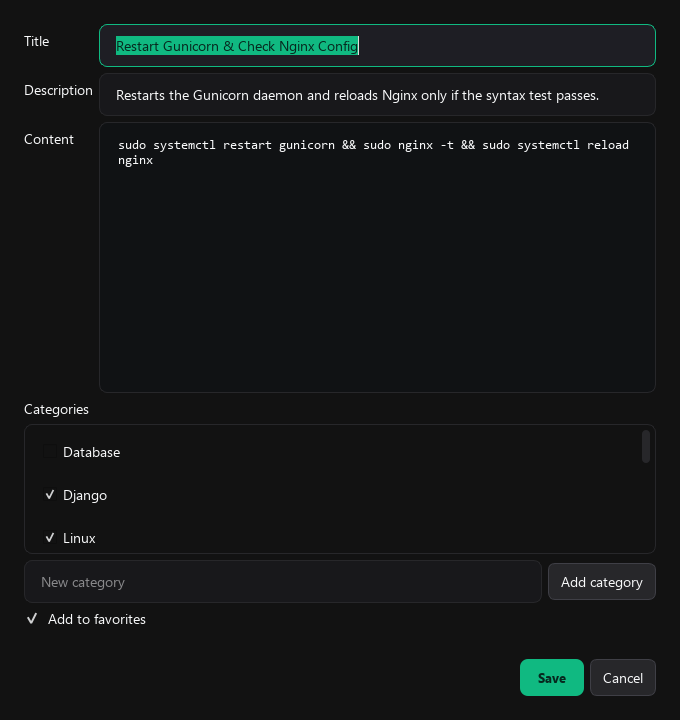

<p align="center">
  
  <h1 align="center">Pro Dash</h1>
  <p align="center">
    <strong>A high-performance, local-first developer workspace for reusable commands, AI prompts, and bookmarks.</strong>
  </p>
  <p align="center">
    <a href="https://team.qrtoba.com"></a>
    <a href="https://pro-dash.qrtoba.com"></a>
    <a href="https://www.patreon.com/c/altohamy"></a>
    <a href="mailto:qrtobacom@gmail.com"></a>
  </p>
  <p align="center">
    
    
    
    
    
  </p>
</p>

---

## 📸 Workspace Preview

<p align="center">
  
</p>

**Pro Dash** gives developers, engineers, and creators a rapid, native desktop hub to store, search, and instantly copy their most trusted terminal commands, battle-tested AI system prompts, and frequently used documentation links — all stored **100% locally on your machine**.

---

## ✨ Features

- **`>_` Terminal Commands Library**: Save complex Docker commands, database backups, Linux shell one-liners, and deploy sequences. Commands are preserved with exact whitespace and formatting; they are never executed by Pro Dash.
- **`✦` AI Prompt Vault**: Organize your system instructions, code review personas, refactoring prompts, and LLM few-shot templates.
- **`↗` Curated Links & Tutorials**: Bookmark documentation, GitHub repositories, video tutorials, and internal dashboards with direct browser launching.
- **⚡ Instant Real-Time Search**: Search simultaneously across titles, content, descriptions, and category tags with debounce optimization.
- **🏷️ Flexible Category Taxonomy**: Assign multiple scoped or shared tags to items, manage and rename categories without losing item associations.
- **⭐ Favorites & Quick Access**: Star frequently needed items for quick access; sort by favorites, recent updates, or alphabetical order.
- **📦 Atomic Portability (Import / Export)**: Export your entire library into a portable JSON pack. Safely merge packs with automatic conflict prevention.
- **🔒 Private & Local-First**: Built with SQLite in Write-Ahead Logging (WAL) mode. Zero analytics, zero accounts, and zero cloud lock-in.
- **🎨 Modern Dark Desktop UI**: Custom Fusion dark theme with emerald accents, High-DPI crisp font rendering, responsive splitters, and persistent window state.

---

## 🖼️ Item Editor

<p align="center">
  
</p>

---

## 🚀 Quick Start (Running from Source)

### Prerequisites
- Python 3.10 or later

### Installation

1. **Clone the repository:**
   ```bash
   git clone https://github.com/kamelaltohamy/pro_dash.git
   cd pro_dash
   ```

2. **Create and activate a virtual environment:**
   - **Windows (PowerShell):**
     ```powershell
     python -m venv .venv
     .\.venv\Scripts\Activate.ps1
     ```
   - **Linux / macOS:**
     ```bash
     python3 -m venv .venv
     source .venv/bin/activate
     ```

3. **Install dependencies:**
   ```bash
   pip install -r requirements.txt
   ```

4. **Launch the application:**
   ```bash
   python main.py
   ```

---

## 📦 Building Standalone Portable Executable (.exe)

You can compile Pro Dash into a standalone, single-file Windows executable that requires **no Python installation**:

```powershell
pip install pyinstaller
pyinstaller prodash.spec
```

The resulting portable binary will be generated at `dist/ProDash.exe`.

- **True Portability**: Drop `ProDash.exe` onto any folder or USB drive. It automatically creates and maintains its local `data/prodash.db` database and preferences alongside the executable.

---

## ⌨️ Keyboard Shortcuts

| Shortcut | Action |
| :--- | :--- |
| <kbd>Ctrl</kbd> + <kbd>N</kbd> | Create a new item in the active library |
| <kbd>Ctrl</kbd> + <kbd>F</kbd> | Jump to and focus the search bar |
| <kbd>Ctrl</kbd> + <kbd>E</kbd> | Edit the currently selected item |
| <kbd>Ctrl</kbd> + <kbd>D</kbd> | Duplicate the selected item |
| <kbd>Ctrl</kbd> + <kbd>Shift</kbd> + <kbd>C</kbd> | Copy the complete content to clipboard |
| <kbd>Ctrl</kbd> + <kbd>B</kbd> | Toggle favorite star on selected item |
| <kbd>Delete</kbd> | Delete the selected item (with confirmation) |
| <kbd>Ctrl</kbd> + <kbd>1</kbd> | Switch to **Commands** library |
| <kbd>Ctrl</kbd> + <kbd>2</kbd> | Switch to **AI Prompts** library |
| <kbd>Ctrl</kbd> + <kbd>3</kbd> | Switch to **Links & Tutorials** library |
| <kbd>F5</kbd> | Refresh library views and update statistics |
| <kbd>Ctrl</kbd> + <kbd>O</kbd> | Import a Pro Dash JSON pack |
| <kbd>Ctrl</kbd> + <kbd>Shift</kbd> + <kbd>S</kbd> | Export complete library to JSON |
| <kbd>Ctrl</kbd> + <kbd>Q</kbd> | Quit application |

*Tip: Double-click any item in the list to immediately open the editor.*

---

## 💖 Support & Community

If you find **Pro Dash** useful and would like to support ongoing development, new features, and creative tech content, please consider supporting us:

<p align="center">
  <a href="https://www.patreon.com/c/altohamy">
    
  </a>
</p>

### Official Channels:
- 🎨 **Patreon**: [kamel altohamy | 3D Designer and like to share my knowledge](https://www.patreon.com/c/altohamy)
- 🌐 **Team Website**: [team.qrtoba.com](https://team.qrtoba.com)
- 🚀 **Live Portal**: [pro-dash.qrtoba.com](https://pro-dash.qrtoba.com)
- ✉️ **Direct Email**: [qrtobacom@gmail.com](mailto:qrtobacom@gmail.com)

---

## 👨‍💻 Author & Credits

- **Creator & Lead Designer**: **Kamel Altohamy** — *3D Designer, Developer & Tech Knowledge Creator*
- **Team**: **Qrtoba Team** ([team.qrtoba.com](https://team.qrtoba.com))

---

## 📄 License

This project is free and open-source software licensed under the **[MIT License](file:///i:/1_Coding/envy_pyside/pro_dash/LICENSE)**.
Feel free to use, modify, and distribute it in your personal and commercial workflows.
